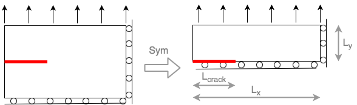

# Computational notebooks — Fracture Mechanics 2026

[](https://github.com/cmaurini/m2-fracture-2026/actions/workflows/test-notebooks.yml)
[](https://codespaces.new/cmaurini/m2-fracture-2026?quickstart=1)
[](https://mybinder.org/v2/gh/cmaurini/m2-fracture-2026/HEAD?labpath=linear-elasticity%2F00-Mesh.ipynb)

Finite element notebooks for the joint Master course in fracture mechanics of
École Nationale des Ponts et Chaussées, Institut Polytechnique de Paris and
Sorbonne Université (MU5MES02 / MEC_53642_EP). They run on
[DOLFINx](https://github.com/FEniCS/dolfinx) **0.11.0**.

## Run it on your machine

Install DOLFINx 0.11, gmsh, PyVista and JupyterLab by following the
instructions, and running the self-test, at

**https://github.com/cmaurini/fenicsx-install**

— conda on Linux and macOS, WSL2 and conda on Windows. They produce the conda
environment `fenicsx-0.11`, the one used here. Then

```bash
git clone https://github.com/cmaurini/m2-fracture-2026.git
cd m2-fracture-2026
conda activate fenicsx-0.11
make kernel
jupyter lab
```

`make kernel` registers the environment as a Jupyter kernel, once. The
notebooks ask for it by name, so from then on they open on the right
environment whichever one JupyterLab was started from: the kernel in the top
right corner should read *FEniCSx 0.11*.

Open `linear-elasticity/00-Mesh.ipynb` and run the cells. The notebooks import
their helper modules from `utils/` through a relative path, so run them from
their own directory — opening them in JupyterLab does this for you.

## Run it online

Both services below start the image built from the environment file of the
installation instructions, so the online environment is the local one.

**[GitHub Codespaces](https://codespaces.new/cmaurini/m2-fracture-2026?quickstart=1)** —
VS Code in the browser, or JupyterLab from its terminal. Files persist between
sessions. Needs a free GitHub account, which gives 120 core-hours a month — 60
hours on the default two-core machine. Stop the codespace when you are done: it
is billed on the time it runs.

**[Binder](https://mybinder.org/v2/gh/cmaurini/m2-fracture-2026/HEAD?labpath=linear-elasticity%2F00-Mesh.ipynb)** —
no account, one click, nothing saved. 2 GB of memory, culled after ten minutes
of inactivity. For looking at the notebooks, not for working in them.

## Contents

| Notebook | What it does |
|---|---|
| [`linear-elasticity/00-Mesh.ipynb`](linear-elasticity/00-Mesh.ipynb) | Builds the mesh of a cracked slab with gmsh, refines it at the crack tip, imports it into DOLFINx, plots it with PyVista and saves it to XDMF. |
| [`linear-elasticity/01-LinearElasticity.ipynb`](linear-elasticity/01-LinearElasticity.ipynb) | Solves plane-stress linear elasticity on that mesh, computes the potential energy and the von Mises stress, plots the deformed configuration, and plots the crack opening and $\sigma_{yy}$ along the line $y=0$. |
| [`linear-elasticity/02-Singularities.ipynb`](linear-elasticity/02-Singularities.ipynb) | Solves plane-strain elasticity on a shouldered bar carrying a crack, a sharp re-entrant shoulder, the same shoulder filleted and an outer corner, and measures the largest $\sigma_{\mathrm{vm}}$ on circles of shrinking radius about each of the four: two of them are unbounded, two are not, and the split is the one the wedge exponent $\lambda(\omega)$ predicts. |
| [`linear-elasticity/03-LEFM.ipynb`](linear-elasticity/03-LEFM.ipynb) | Reads the stress intensity factor $K_I$ off the elastic solution of `01-LinearElasticity`, twice: by extrapolating the crack opening along the crack faces, and by extrapolating $\sigma_{xx}\sqrt{2\pi r}$ ahead of the tip. Then computes the energy release rate $G$ twice as well, by a finite difference of the potential energy with respect to the crack length, and by the G-theta method, the same derivative taken on a fixed mesh. Irwin's formula $G=K_I^2/E$ ties the four numbers together. |

The geometry of `00-Mesh`, `01-LinearElasticity` and `03-LEFM` is half of an
elastic slab with a straight crack, the half being taken by symmetry:



`02-Singularities` stands on its own: it builds its own part, and meshes the
crack as an embedded line opened by gmsh's `Crack` plugin, so that the two crack
faces are distinct material surfaces.

**Homework 2026.** The starting notebook of the homework, the DCDC test, is in
[`homework-2026/`](homework-2026/), with blanks left for you to fill in.

Helper modules, imported by the notebooks:

| Module | Contents |
|---|---|
| [`utils/meshes.py`](utils/meshes.py) | `generate_mesh_with_crack`, the mesh of `00-Mesh` as a function. |
| [`utils/plots.py`](utils/plots.py) | `warp_plot_2d`, a PyVista plot of a field on the deformed mesh. |
| [`utils/elastic_solver.py`](utils/elastic_solver.py) | `solve_elasticity`, the whole of `01-LinearElasticity` as a function, returning the displacement, the potential energy and the stress. |
| [`utils/evaluation.py`](utils/evaluation.py) | `evaluate_function`, the values of a finite element function at a set of points, in serial and in parallel. A copy of [`scifem.evaluate_function`](https://scientificcomputing.github.io/scifem/), carried here so that the notebooks run without scifem installed. |
| [`utils/mesh_dcdc.py`](utils/mesh_dcdc.py) | `build`, the mesh of the quarter DCDC specimen, and `plot_tags`, a plot of its tagged elements. For the homework. |
| [`utils/solve_dcdc.py`](utils/solve_dcdc.py) | `solve`, the DCDC specimen at $E=\sigma=R=1$; $G$ by the crack opening, the finite difference of the energy and G-theta; the published fits. For the homework. |

Results are written to `linear-elasticity/output/`, in a form
[ParaView](https://www.paraview.org/) reads.

## Check that it works

```bash
conda activate fenicsx-0.11
make test
```

This executes the notebooks and checks the run: no cell raised, PyVista and
matplotlib drew their figures, and the computed potential energies, stresses and
singular exponents are the expected ones. The homework notebook has blank cells
and is not run; `tools/check_homework.py` checks its two modules. CI runs the same check on every push
and every Monday morning, on Linux and macOS in the conda environment of the
installation instructions, and in the image Codespaces and Binder launch.

That image, [`docker/Dockerfile`](docker/Dockerfile), takes its environment
from [cmaurini/fenicsx-install](https://github.com/cmaurini/fenicsx-install),
the one students install: no list of packages is kept here, and
[`tools/check_environment.py`](tools/check_environment.py) imports everything
that file names, so a package added there and missing online fails the build.
It is published to `ghcr.io/cmaurini/m2-fracture-2026:env-0.11` only after every
notebook has run in it.

## Further material

- The full notebook collection of the [NEWFRAC](https://www.newfrac.eu) network,
  covering LEFM, plasticity, phase-field and dynamics:
  https://github.com/newfrac/fenicsx-fracture
- The DOLFINx tutorial by Jørgen S. Dokken: https://jsdokken.com/dolfinx-tutorial/
- FEniCS documentation: https://docs.fenicsproject.org/

## Provenance and license

Derived from [newfrac/fenicsx-fracture](https://github.com/newfrac/fenicsx-fracture),
notebooks `notebooks/linear-elasticity/00-Mesh.ipynb`,
`01-LinearElasticity.ipynb` and `02-LEFM.ipynb` with their helper modules,
verified against DOLFINx 0.11.0.

Authors: Corrado Maurini (Sorbonne Université), Laura De Lorenzis (ETH Zürich)
and Véronique Lazarus (ENSTA, Institut Polytechnique de Paris).

MIT, see [LICENSE](LICENSE).
